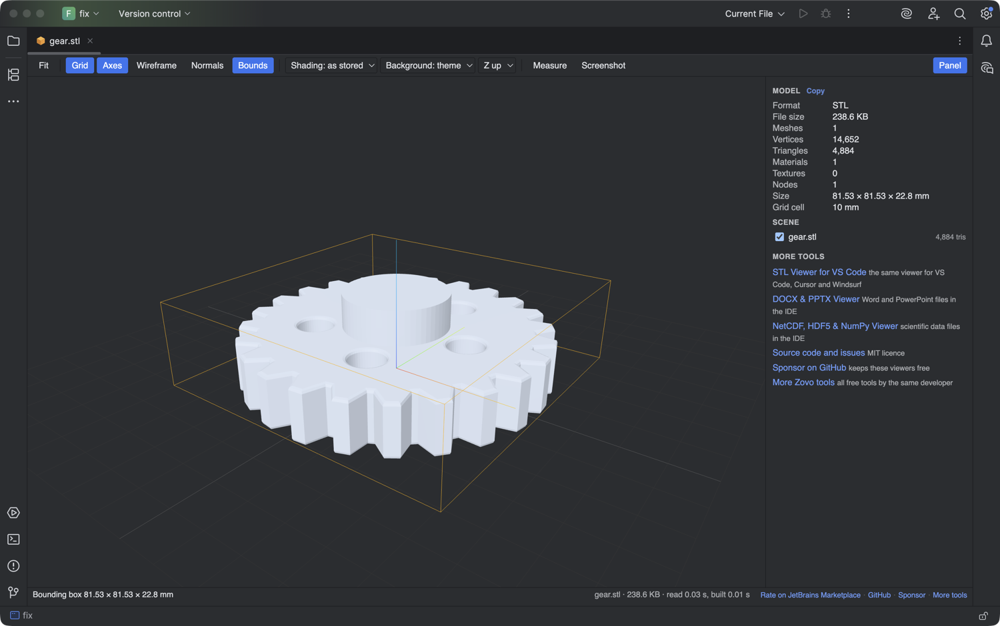

# STL Viewer & 3D Model Preview for JetBrains IDEs

Open STL, OBJ, PLY, 3MF, GLB and glTF files (.stl, .obj, .ply, .3mf, .glb, .gltf) as 3D models in an editor tab of IntelliJ IDEA, PyCharm, WebStorm, CLion, Rider and the other IDEs built on the IntelliJ Platform (2025.2 and later).



## What you can do

- Orbit, pan and zoom. Fit (F) and the up axis (Y or Z) bring the model back.
- Wireframe, vertex normals, grid, axes and a bounding box, each one click or one key away.
- Size in millimetres for STL and 3MF, plus triangle, vertex, mesh and material counts. Copy the stats as text.
- Measure the distance between two points on the surface.
- Flat or smooth shading, and a dark, light or theme background.
- Play glTF and GLB animations. Hide or frame single parts in the scene tree.
- Save the view as a PNG through the IDE save dialog. The model file is never changed.

Formats:

- STL, binary and ASCII
- OBJ with its .mtl materials and textures from the same folder
- PLY meshes and point clouds, with vertex colours
- 3MF packages
- GLB and glTF 2.0 with PBR materials, external .bin buffers and textures

Everything is read-only and offline. The viewer makes no network calls. The one exception is the "Rate on JetBrains Marketplace" link (it shows after 3 models opened without an error): when you click it, the plugin asks plugins.jetbrains.com for its own page address and opens it in your browser.

## Install

Settings | Plugins | Marketplace, search for "STL Viewer". Or download the zip from the Marketplace page and use "Install Plugin from Disk".

## How it works

The editor tab is a JCEF browser. Its page comes from a private origin, `http://zovo-model/`, which the plugin serves itself (`zovo.jcefshell.ShellScheme`). Nothing goes over the network.

- The page reads the model by byte range: `GET /t/<token>/f/<name>?offset=&length=`, 8 MB per request, straight into an ArrayBuffer in the page. The IDE never holds the whole file, so a 200 MB STL does not load the IDE's memory or freeze it. The token is random per open tab and is removed when the tab closes.
- Files next to the model (.mtl, .bin, textures) come from the same route. Only the model's folder and its sub-folders can be read: `..`, encoded `..` and symlinks that lead out of the folder get HTTP 404.
- Screenshots and copied stats go back to the IDE through `POST /t/<token>/save` and `/copy`. The IDE shows its own save dialog and never writes over the model.
- Without WebGL (some remote or Linux setups) the tab shows facts read in Kotlin, such as the triangle count from the STL header, and an "Open in Default App" button. Without JCEF the tab shows the same facts in a plain panel.
- STL and 3MF are shown in millimetres. STL files carry no unit; slicers and CAD tools read them as millimetres.

## Build

The browser bundle is committed in `src/main/resources/web`, so the Gradle build needs no Node.

```
cd web && npm ci && npm run bundle && npm test   # rebuild the bundle, run the JS tests
cd .. && ./gradlew test verifyPlugin buildPlugin  # JDK 21+
./gradlew runIde                                  # sandbox IDE
```

`web/src/core` and `web/src/webview` are the files of [model-viewer-vscode](https://github.com/theluckystrike/model-viewer-vscode) 0.1.7, unchanged (a test compares them). Only the host side is new: `web/src/jb/shim.js` replaces the VS Code extension host, and `web/src/jb/host.js` turns the model's fetches into range reads. The JCEF shell (`zovo.jcefshell`) comes from [science-data-viewer-jetbrains](https://github.com/theluckystrike/science-data-viewer-jetbrains), with a route for the files next to the model.

[zovo-support-start]: #

## Support Zovo

Zovo builds and maintains this plugin. If it saves you time, you can support the work on [GitHub Sponsors](https://github.com/sponsors/theluckystrike). Sponsorship is optional, and the tool works the same without it.

Bug reports and ideas go to [GitHub issues](https://github.com/theluckystrike/stl-viewer-jetbrains/issues).

## More tools by Zovo

- [STL Viewer, OBJ Viewer, GLB & glTF Viewer](https://marketplace.visualstudio.com/items?itemName=zovo.3d-model-viewer) for VS Code, Cursor and Windsurf. The same viewer.
- [DOCX & PPTX Viewer](https://plugins.jetbrains.com/plugin/35878) for JetBrains IDEs. Opens Word and PowerPoint files read-only in an editor tab.
- [NetCDF, HDF5 & NumPy Viewer](https://plugins.jetbrains.com/plugin/35879) for JetBrains IDEs. Browses scientific data files and plots slices.
- [All Zovo tools on GitHub](https://github.com/theluckystrike?tab=repositories). Free tools for VS Code, JetBrains IDEs, Obsidian and more.

[zovo-support-end]: #

## License

MIT. The bundle includes three.js 0.187.0 (MIT); see THIRD-PARTY-NOTICES.md.
